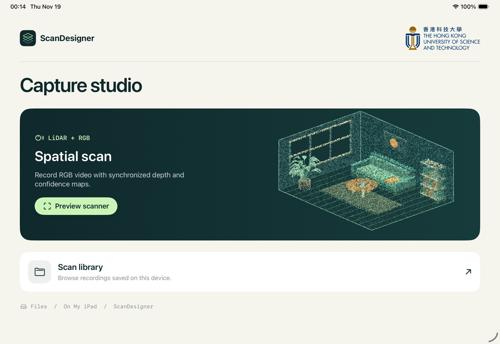

# PawSpace

PawSpace records synchronized RGB video, raw LiDAR depth, confidence and camera poses locally on a LiDAR-equipped iPad or iPhone. Open the camera, wait for LiDAR readiness, tap **Record scan**, then **Stop & save**. In the Mac simulator, **Preview scanner** runs the same recording pipeline with explicitly synthetic sensor data.

Each finished scan appears in **Scan library** and in **Files → On My iPad (or iPhone) → PawSpace** (ScanDesigner on older versions). Existing folders in the app’s Documents directory remain browsable. See the [installation instructions](doc/INSTALL.md).



## Recording format

The original `ScanDesigner.depth` format identifier remains unchanged for backward compatibility.

| File | Contents |
| --- | --- |
| `rgb.mp4` | H.264 color video at the camera’s native image dimensions. |
| `depth.zip` | Lossless DEFLATE archive with original Float32 depth in metres, UInt8 ARKit confidence levels, frame dimensions and timestamps. |
| `camera.jsonl` | One JSON object per accepted frame, in video presentation order. Includes camera intrinsics, transform, Euler angles, quaternion (w, x, y, z), exposure duration and capture timestamp in nanoseconds. Matrices use column-major order. |

The manifest records the accepted frame count and the number of observed frames skipped during capture. The archive writer copies valid pixels from each row, discards Core Video row padding and writes small batches during capture. Each ZIP member has a CRC. Only complete RGB/depth/confidence tuples are admitted. If the encoder or disk queue is busy, the next accepted tuple retains its original timestamp. Final folders appear after both the movie and archive close. If the process is interrupted, the next launch exposes the remaining files in a folder marked **Incomplete**. An unfinished ZIP may need recovery.

Unzip `depth.zip` with Files or a standard ZIP reader. For every `index/NNNNNNNN.json`, the matching `depth/NNNNNNNN.f32le` and `confidence/NNNNNNNN.u8` contain tightly packed arrays in frame, row, column order. The number in the filename is the zero-based index of the first frame in that batch. Each index provides `width`, `height` in `layout` and one `timestampsNS` entry per frame. A timestamp is measured from device boot. Subtract the first accepted timestamp to align with video playback.

The following example reads one batch at a time with Python and NumPy.

```python
import json
import zipfile
import numpy as np

with zipfile.ZipFile("depth.zip") as archive:
    for path in sorted(n for n in archive.namelist() if n.startswith("index/")):
        key = path.split("/")[1].split(".")[0]
        index = json.loads(archive.read(path))
        layout = index["layout"]
        shape = (len(index["timestampsNS"]), layout["height"], layout["width"])
        depth = np.frombuffer(archive.read(f"depth/{key}.f32le"), dtype="<f4").reshape(shape)
        confidence = np.frombuffer(archive.read(f"confidence/{key}.u8"), dtype="u1").reshape(shape)
        # depth[i, y, x] and confidence[i, y, x] belong to timestampsNS[i].
```

Run `tests/verify-depth.sh` on macOS to verify the production archive writer against known pixel bit patterns, padded rows, batch boundaries and a resolution change.

The university artwork comes from the [HKUST Graphic Identity Usage Guidelines](https://logo.ust.hk/img/downloads/HKUST_Graphic_Identity_Usage_Guideline.pdf). ZIP writing uses the bundled [MiniZip sources from zlib 1.3.1](https://zlib.net/fossils/zlib-1.3.1.tar.gz) and Apple’s system zlib.
